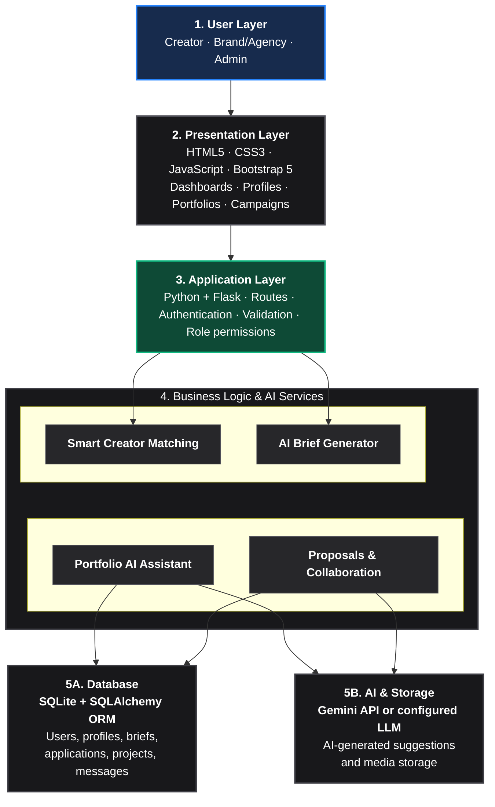

# Creatora AI — AI Content Creator Marketplace

> **Tagline:** *Create. Connect. Collaborate.*

**Creatora AI** is a full-stack AI-powered marketplace connecting generative AI content creators with forward-thinking brands and creative agencies. Creators showcase their generative video pipelines, prompt engineering methodology, and commercial portfolios. Brands build structured campaign briefs with an AI Brief Builder, discover creators through an **Explainable 7-Factor AI Matching Engine**, verify commercial tool licensing, and manage production through a real-time collaborative workspace.

---

##  Key Features

### 1. Multi-Role System with Server-Side RBAC
- **Creators:** Manage public profile, portfolio items with generative tool pipelines, applications, proposals, and project collaboration workspaces.
- **Brands & Agencies:** Manage company profile, post campaign briefs, run Explainable AI Creator Matching, shortlist candidates, invite talent, and review draft submissions.
- **Administrators:** Review creator verification requests, audit security logs, moderate content and reports, and manage platform users.

### 2. AI Campaign Brief Builder (Google Gemini + Rule Fallback)
- Converts natural language concepts (e.g., *"I need an AI video ad for our new radiant hyaluronic acid serum for TikTok"*) into structured production briefs.
- Generates campaign objectives, target channels, aspect ratios, required AI tools, delivery schedules, and acceptance criteria.
- Validates fields and prompts brands to resolve missing specifications before publishing.

### 3. Explainable 7-Factor AI Creator Matching
- Evaluates candidate compatibility using normalized weighted scoring:
  - **Skills Match:** 25%
  - **Portfolio Relevance:** 25%
  - **Specialization Alignment:** 15%
  - **AI Tools & Models:** 10%
  - **Output Format Compatibility:** 10%
  - **Budget Compatibility:** 10%
  - **Availability:** 5%
- Features interactive scoring weight sliders, transparent breakdown progress meters, concrete strengths explanations, and cautions for missing information.
- Eliminates popularity bias to give new creators fair opportunities based on genuine portfolio fit.

### 4. Commercial Usage & Licensing Assistant
- Evaluates generative models (Midjourney, Runway Gen-3, ElevenLabs, Kling AI, Flux.1) against commercial advertising requirements.
- Flags licensing conditions (e.g., paid tier commercial rights, voice broadcast restrictions) and missing asset declarations.
- Outputs transparent compatibility badges (*Compatible*, *Review Required*, *Insufficient Information*).

### 5. Project Collaboration Workspace
- Structured milestone tracking (`Pending` &rarr; `Submitted` &rarr; `Approved`).
- Version-controlled draft submissions (`v1`, `v2`...) with media preview links and revision notes.
- In-workspace real-time discussion stream.
- Final brand approval with automatic completion status.

### 6. Analytics & Modern Glassmorphic UI
- Responsive Bootstrap 5 interface with dark/light mode toggle.
- Interactive Chart.js charts for application pipelines, campaign distributions, and profile completeness meters.
- One-click PDF export of campaign briefs using ReportLab.

---

##  System Architecture


┌─────────────────────────────────────────────────────────────────────────────┐
│                                1. User Layer                                │
│                        Creator · Brand/Agency · Admin                       │
└─────────────────────────────────────────────────────────────────────────────┘
                                       │
                                       ▼
┌─────────────────────────────────────────────────────────────────────────────┐
│                            2. Presentation Layer                            │
│                   HTML5 · CSS3 · JavaScript · Bootstrap 5                   │
│                Dashboards · Profiles · Portfolios · Campaigns               │
└─────────────────────────────────────────────────────────────────────────────┘
                                       │
                                       ▼
┌─────────────────────────────────────────────────────────────────────────────┐
│                            3. Application Layer                             │
│    Python + Flask · Routes · Authentication · Validation · Role permissions │
└─────────────────────────────────────────────────────────────────────────────┘
                                       │
                                       ▼
┌─────────────────────────────────────────────────────────────────────────────┐
│                       4. Business Logic & AI Services                       │
│  ┌───────────────────────────────────┐   ┌───────────────────────────────┐  │
│  │      Smart Creator Matching       │   │      AI Brief Generator       │  │
│  └───────────────────────────────────┘   └───────────────────────────────┘  │
│  ┌───────────────────────────────────┐   ┌───────────────────────────────┐  │
│  │      Portfolio AI Assistant       │   │   Proposals & Collaboration   │  │
│  └───────────────────────────────────┘   └───────────────────────────────┘  │
└─────────────────────────────────────────────────────────────────────────────┘
                                       │
                   ┌───────────────────┴───────────────────┐
                   ▼                                       ▼
┌─────────────────────────────────────┐ ┌─────────────────────────────────────┐
│            5A. Database             │ │          5B. AI & Storage           │
│       SQLite + SQLAlchemy ORM       │ │     Gemini API or configured LLM    │
│    Users, profiles, briefs,         │ │       AI-generated suggestions      │
│  applications, projects, messages   │ │          and media storage          │
└─────────────────────────────────────┘ └─────────────────────────────────────┘
```

<details>
<summary><b>Click to expand Mermaid Flowchart</b></summary>



</details>

### Architectural Breakdown

| Layer | Components & Technologies | Description |
|---|---|---|
| **1. User Layer** | Creator · Brand/Agency · Admin | Multi-role entry point for distinct actor workflows with server-enforced role boundaries. |
| **2. Presentation Layer** | HTML5, CSS3, JavaScript, Bootstrap 5 | Cyber-glass UI, interactive dashboards, dynamic portfolios, campaign explorers, and responsive views. |
| **3. Application Layer** | Python + Flask | Modular Blueprints, session handling, authentication, CSRF validation, and `@role_required` access control. |
| **4. Business Logic & AI Services** | • **Smart Creator Matching**<br/>• **AI Brief Generator**<br/>• **Portfolio AI Assistant**<br/>• **Proposals & Collaboration** | Core platform intelligence: 7-factor weighted matching, natural language prompt decomposition, generative pipeline validation, and milestone workflows. |
| **5A. Database** | SQLite + SQLAlchemy ORM | Relational models storing users, profiles, briefs, applications, project milestones, and messaging threads. |
| **5B. AI & Storage** | Google Gemini API (or configured LLM) & Local Media Storage | Multimodal generation, structured brief synthesis, AI recommendations, and secure media uploads. |

---

##  Mandatory Tech Stack

- **Backend:** Python 3.12, Flask, Flask-SQLAlchemy, Flask-Login, Flask-WTF (CSRF Protection), Werkzeug.
- **Database:** SQLite (ORM-managed via SQLAlchemy with indexes, foreign keys, and constraints).
- **Artificial Intelligence:** Google Gemini API (`gemini-2.5-flash` / `gemini-1.5-flash`) with robust rule-based fallback.
- **Frontend:** HTML5, CSS3 (Custom design system in `static/css/custom.css`), JavaScript, Bootstrap 5, Bootstrap Icons, Chart.js.
- **PDF Generation:** ReportLab.
- **Testing:** pytest.

---

##  Quickstart Guide

### 1. Prerequisites
- Python 3.10+ (Python 3.12 recommended)
- Git

### 2. Clone and Setup Environment
```bash
git clone https://github.com/your-username/creatora-ai.git
cd creatora-ai

# Create virtual environment
python -m venv venv

# Activate virtual environment
# Windows:
.\venv\Scripts\activate
# Linux/macOS:
source venv/bin/activate

# Install dependencies
pip install -r requirements.txt
```

### 3. Environment Configuration
Copy `.env.example` to `.env`:
```bash
cp .env.example .env
```
*(Optional)* Add your Google Gemini API key in `.env` to enable live LLM synthesis:
```env
GEMINI_API_KEY=your_actual_gemini_api_key_here
```
> **Note:** If no API key is provided, Creatora AI automatically activates its comprehensive rule-based fallback mode.

### 4. Initialize Database & Seed Demo Data
```bash
python seed.py
```

### 5. Run the Application
```bash
python app.py
```
Open your browser and navigate to: `http://127.0.0.1:5000`

---

##  Demo Accounts (1-Click Login Ready)

The login page features 1-click quick-fill buttons for hackathon judges and evaluators:

| Role | Email | Password | Description |
|---|---|---|---|
| **Administrator** | `admin@creatora.ai` | `AdminPass123!` | Moderation, creator verification, audit logs |
| **Brand (Aura Glow)** | `contact@auraglow.com` | `BrandPass123!` | Skincare brand with active briefs & received proposals |
| **Creator (Elena)** | `elena.ai@creatora.ai` | `CreatorPass123!` | Verified AI director (Runway Gen-3, Midjourney v6) |
| **Creator (Marcus)** | `marcus.render@creatora.ai` | `CreatorPass123!` | 3D motion & cyberpunk visuals artist |
| **Creator (Chloe)** | `chloe.synth@creatora.ai` | `CreatorPass123!` | Fashion stylist (Pending verification) |

---

##  Running Automated Tests

Run the test suite with pytest:
```bash
pytest
```
Expected output:
```text
tests/test_auth.py ...          [ 50%]
tests/test_licensing.py ..      [ 83%]
tests/test_matching.py .        [100%]
======================== 6 passed ========================
```

---

##  Project Structure

```text
creatora-ai/
├── app.py                      # Flask application factory, routes registration & error handlers
├── config.py                   # Development, testing, and production configurations
├── requirements.txt            # Python package dependencies
├── seed.py                     # Database seeding script with realistic demo data
├── .env.example                # Example environment variables
├── README.md                   # Complete documentation
├── models/
│   ├── __init__.py             # SQLAlchemy instance and model exports
│   ├── user.py                 # User model with role helpers and password hashing
│   ├── creator.py              # CreatorProfile, VerificationRecord, SavedCampaign
│   ├── portfolio.py            # PortfolioItem, PortfolioTool
│   ├── brand.py                # BrandProfile, SavedCreator
│   ├── brief.py                # CreativeBrief, BriefRequirement
│   ├── application.py          # Application, RecommendationFeedback
│   ├── project.py              # Project, ProjectMilestone, RevisionRecord
│   └── messaging.py            # Message, Notification, Report, AuditLog
├── routes/
│   ├── __init__.py             # Blueprint registration
│   ├── auth_routes.py          # Login, register, logout, RBAC decorators, settings
│   ├── creator_routes.py       # Creator dashboard, profile edit, portfolio CRUD
│   ├── brand_routes.py         # Brand dashboard, profile edit, saved creators
│   ├── brief_routes.py         # Briefs directory, CRUD, AI builder, PDF export
│   ├── matching_routes.py      # Explainable AI matching engine & invitations
│   ├── application_routes.py   # Applications submit, AI proposal generator, status updates
│   ├── project_routes.py       # Project collaboration workspace, revisions, approvals
│   ├── messaging_routes.py     # In-app messaging and threaded inbox
│   ├── notification_routes.py  # In-app notifications center
│   └── admin_routes.py         # Admin moderation, verification reviews, audit logs
├── services/
│   ├── __init__.py             # Service exports
│   ├── ai_service.py           # Gemini API integration & rule-based fallback
│   ├── matching_service.py     # 7-factor explainable matching algorithm
│   ├── licensing_service.py    # Commercial tool licensing compliance checker
│   ├── verification_service.py # Verification workflow and audit tracking
│   ├── notification_service.py # In-app notification dispatcher
│   └── portfolio_service.py    # Safe file uploads and security validation
├── static/
│   ├── css/custom.css          # Modern cyber-glass design system & animations
│   ├── js/main.js              # Theme switcher, bookmarks AJAX, sliders
│   ├── images/                 # Default SVG avatars and logos
│   └── uploads/                # Upload directories for media and deliverables
├── templates/                  # Jinja2 templates for all pages
└── tests/                      # pytest test suite
```

---

##  Security & Best Practices

- **Password Security:** Scrypt/PBKDF2 hashing via Werkzeug with salt.
- **CSRF Protection:** Flask-WTF tokens enforced across all POST forms and AJAX requests.
- **Access Control:** Server-side `@role_required` decorators preventing privilege escalation.
- **File Upload Safety:** UUID renaming, filename sanitization via `secure_filename`, extension whitelisting, and path traversal prevention.
- **Data Privacy:** Sensitive API keys stored exclusively in environment variables and never exposed to the frontend.
- **Legal Notice:** Commercial licensing status reports explicitly state they provide informational audits rather than legal guarantees.

---

##  License
MIT License. Built for the College Hackathon Showcase and real-world deployment.
